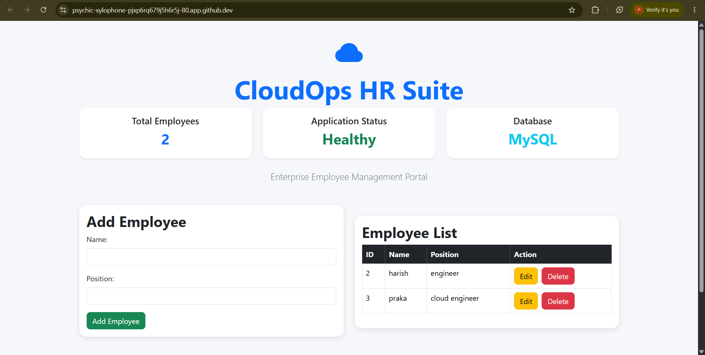
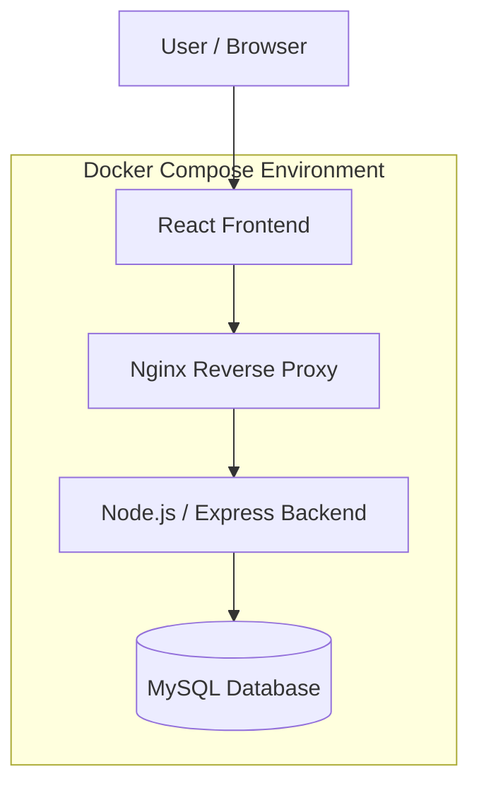

# CloudOps HR Suite – Employee Management Platform

A containerized full-stack employee management application demonstrating Docker-based deployment, automated CI testing, Docker image publishing, health checks, and application logging.

## Project Overview

CloudOps HR Suite is a full-stack employee management platform developed using React.js, Node.js, Express.js, and MySQL.

The project demonstrates containerization, multi-container orchestration, automated integration testing, and Docker image publishing using GitHub Actions and GitHub Container Registry (GHCR).

**Project Type:** Cloud & DevOps Portfolio Project

## Application Dashboard



## Key Features

- Add, view, update, and delete employee records.
- React-based frontend interface.
- Node.js and Express.js REST API.
- MySQL database integration.
- Docker-based application containerization.
- Multi-container orchestration using Docker Compose.
- Nginx reverse proxy configuration.
- Automated API integration testing.
- GitHub Actions CI pipeline.
- Automated Docker image publishing to GHCR.
- Backend health-check endpoint.
- HTTP request logging.

## Technology Stack

| Category | Technologies |
|---|---|
| Frontend | React.js, Bootstrap |
| Backend | Node.js, Express.js |
| Database | MySQL |
| Containerization | Docker, Docker Compose |
| Web Server | Nginx |
| CI | GitHub Actions |
| Container Registry | GitHub Container Registry |
| Version Control | Git, GitHub |
| Testing | Node.js API Integration Tests |

## System Architecture

The application follows a three-tier architecture with Docker Compose managing the application services.



All application services run as separate Docker containers connected through a Docker Compose network.

## DevOps Implementation

### 1. Docker Containerization

- Created separate Dockerfiles for the frontend and backend.
- Configured Nginx to serve the frontend and forward API requests.
- Used Docker Compose to manage frontend, backend, and MySQL services.
- Configured database initialization using a MySQL schema file.

### 2. Continuous Integration – GitHub Actions

Implemented an automated CI workflow that:

- Checks out the source code.
- Builds frontend and backend Docker images.
- Starts application services using Docker Compose.
- Verifies application availability.
- Executes automated employee API tests.
- Validates the backend health endpoint.
- Captures application logs.
- Cleans up containers and test volumes after execution.

### 3. Docker Image Publishing – GHCR

Implemented a separate GitHub Actions workflow that runs after successful CI completion.

- Authenticates with GitHub Container Registry using `GITHUB_TOKEN`.
- Builds frontend and backend Docker images.
- Publishes both images to GHCR.
- Tags images using `latest` and the corresponding commit SHA.

### 4. Health Checks and Logging

- Implemented a backend `/health` endpoint.
- Returns application status and timestamp.
- Added HTTP request logging middleware.
- Captures Docker container logs through GitHub Actions.

## Docker Images

The following images are published to GitHub Container Registry:

**Backend**

```text
ghcr.io/rprakashini/cloudops-hr-suite-backend:latest
```

**Frontend**

```text
ghcr.io/rprakashini/cloudops-hr-suite-frontend:latest
```

## Running the Application Locally

### Prerequisites

- Git
- Docker
- Docker Compose

### 1. Clone the Repository

```bash
git clone https://github.com/RPrakashini/CloudOps-HR-Suite

cd CloudOps-HR-Suite
```

### 2. Start the Application

```bash
docker compose up --build -d
```

This starts the MySQL database, backend API, and frontend containers.

The database schema is initialized automatically during the first MySQL initialization.

### 3. Access the Application

**Frontend**

```text
http://localhost
```

**Backend Health Endpoint**

```text
http://localhost:5000/health
```

### 4. Stop the Application

```bash
docker compose down
```

To remove the local database volume as well:

```bash
docker compose down --volumes
```

**Note:** The Compose database credentials are intended for local demonstration and testing only. Use secure credentials and appropriate secrets management for production.

## Project Validation

The project has successfully passed the following automated checks in GitHub Actions:

- Frontend and backend Docker image builds.
- MySQL database initialization.
- Docker Compose multi-container integration.
- Employee Create, Read, Update, and Delete API tests.
- Backend health endpoint verification.
- Docker image publishing to GHCR.
- Application log capture.

## Deployment Status

The project currently demonstrates automated CI, container integration testing, and Docker image publishing.

The application has also been run and tested in GitHub Codespaces.

Deployment to a public cloud environment, production infrastructure, and live cloud monitoring are future enhancements.

## Repository

**GitHub:** https://github.com/RPrakashini/CloudOps-HR-Suite

## Future Enhancements

- Cloud deployment using AWS.
- Infrastructure provisioning using Terraform.
- Advanced monitoring and alerting.
- Centralized logging.
- Kubernetes-based orchestration.
- Deployment automation.

## Author

Developed as a hands-on Cloud and DevOps portfolio project.
